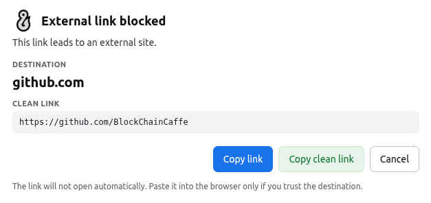
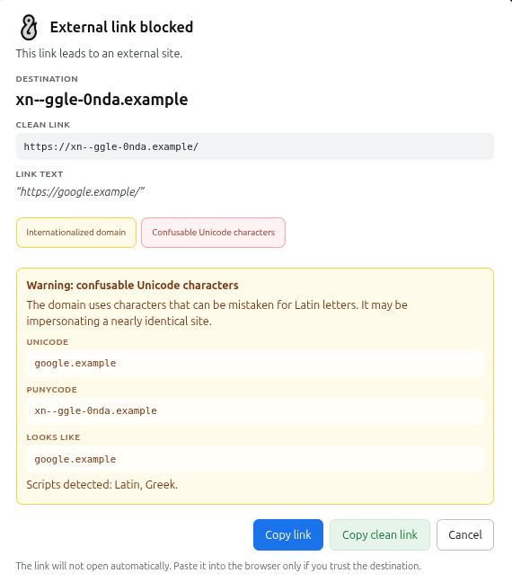
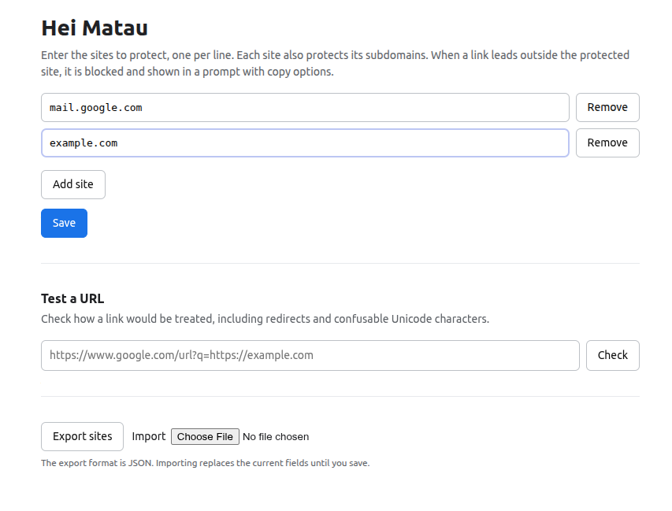

# Hei Matau


Hei Matau **protects webmail and other sensitive sites from phishing links**. You list the sites you want to protect. On those sites, any link that points outside the protected host is blocked and shown in a decision popup.

The extension **never opens the link**. It only lets you inspect the destination, copy the original link, or copy a cleaned link.

---

## Table of Contents

- [Why the name](#why-the-name)
- [Installation](#installation)
- [Behavior](#behavior)
- [Redirects and Gmail](#redirects-and-gmail)
- [Unicode and homograph warning](#unicode-and-homograph-warning)
- [Settings](#settings)
- [Limitations](#limitations)
- [Testing](#testing)
  - [Manual browser test](#manual-browser-test)
  - [Automated checks](#automated-checks)

---

## Rationale

I needed a way to mitigate phishing attacs, but could not find one that did what I needed the way I wanted it. Plus almost none of them was **opensource**, so I did not trust them and preferred to make my own.


According to [Wikipedia](http://en.wikipedia.org/wiki/Hei_matau) 
> a hei matau is a bone or greenstone carving in the shape of a highly stylised fish hook. They represent good luck and safe travel across water.

Since the project deals with phishing, it seemd a good fit...


## Supported Browsers

This estension _should_ work with the following Chromium based browsers:

- Google Chrome
- Chromium
- Brave
- Microsoft Edge
- Opera and Opera GX
- Vivaldi
- Arc
- Yandex Browser

> **Does not work on Firefox**

Please let me have some feedback it Hei Matau does not work on your browser or works on an unlisted one

## Installation

For the time beying the extention is not in any repository. If you want to use it just follow these steps:

1. Download and Extract the ZIP file.
2. Inspect the code
3. Open `brave://extensions` or `chrome://extensions` and enable **Developer mode**.
4. Click **Load unpacked** and select the `Hei Matau` folder.
5. Click the extension icon to open the settings and add your protected sites.

## Behavior



- A protected site also covers all of its subdomains. Adding `mail.google.com` protects `mail.google.com` and any subdomain of it.
- Links are checked when they would leave the protected host.
- The popup actions are **Cancel**, **Copy link**, and **Copy clean link**.
  - **Copy link** copies the original `href`.
  - **Copy clean link** follows known redirect wrappers and removes known tracking parameters.
- Normal clicks, middle-clicks, Ctrl/Cmd-clicks, Enter activation, form submissions, right-click menus on external links, and drag-and-drop on external links are all intercepted.
- Iframes relay their intercepted links to the top frame, where the popup is shown.

## Redirects and Gmail

Gmail links often point to `https://www.google.com/url?q=<real-url>` and include a `data-saferedirecturl` attribute. Hei Matau unwraps Google redirects and similar wrappers (Outlook SafeLinks, Facebook, LinkedIn, Proofpoint, and others) before deciding whether a link is external.

This matters because a link to `https://www.google.com/url?q=https://evil.example` must be evaluated as `evil.example`, not as `www.google.com`.

If the final destination cannot be determined, for example because the link uses a shortener such as `bit.ly`, the popup says so and warns that the cleaned link may not be final.

## Unicode and homograph warning

Hostnames that use internationalized characters are stored by browsers as punycode (`xn--...`). Hei Matau decodes them for display and checks for:

- mixed scripts inside the hostname, such as Latin and Cyrillic;
- confusable characters that look like Latin letters;
- invisible or bidirectional control characters;
- characters that change form after Unicode normalization.

When such a domain is detected, the popup shows a prominent warning with the Unicode form, the punycode form, and a rough Latin lookalike. This helps expose domains such as `pаypal.com`, where the `а` is Cyrillic.





Legitimate internationalized domains are still shown with an informational note and their Unicode and punycode forms.

## Settings



The settings page supports:

- adding and removing protected sites;
- validation of each entry;
- testing a URL to see how it would be treated;
- exporting and importing the protected-site list as JSON;
- automatic migration from the old `domains` storage format.

## Limitations

- Navigation triggered by `window.open`, `location.href`, or similar JavaScript is not intercepted. The extension targets links, forms, context menus, and drag-and-drop.
- Links inside closed shadow roots of the page cannot be inspected.
- Shortened links and redirect wrappers that cannot be resolved offline are flagged, but the final destination cannot be verified.
- The extension only runs its checks on sites you explicitly add to the protected list.

## Testing

### Manual browser test

The repository includes `test-page.html`, a page with links for every supported blocking case, including similar-looking domains and safe internal controls.

1. Start a local web server from the project root:

   ```sh
   python3 -m http.server 8000
   ```

2. Open the test page in the browser:

   ```text
   http://127.0.0.1:8000/test-page.html
   ```

3. Open the Hei Matau settings and add the host shown on the test page. With the command above, add `127.0.0.1`. Do not include the port.
4. Reload the test page.
5. Click each external test link. Every external link should be blocked with the Hei Matau popup. Internal control links should reload the page without a popup.
6. Repeat the basic checks with normal click, middle click, Ctrl/Cmd-click, Enter on a focused link, right-click, and drag-and-drop.
7. Submit the external test form. It should show “Form submission blocked” and must not send the form.
8. Check the popup content for each case:
   - redirect wrappers show the unwrapped destination and a cleaned link;
   - shorteners and unresolved redirects show a warning;
   - Unicode homographs show the Unicode host, punycode host, and Latin lookalike;
   - legitimate internationalized domains show an informational note, not the red homograph warning;
   - userinfo, IP, HTTP, port, many-subdomain, text-mismatch, and unsafe-protocol cases show their corresponding warning chips.
9. Use **Cancel** or Escape to close each popup before testing the next link.

If a link opens normally, the current host is not in the protected list or the extension is not active on the page. The test page must be opened over HTTP or HTTPS; `file://` pages are not matched by the extension.

### Automated checks

Run the URL and Unicode tests with:

```sh
npm test
```

Syntax-check the extension files with:

```sh
npm run check
```
